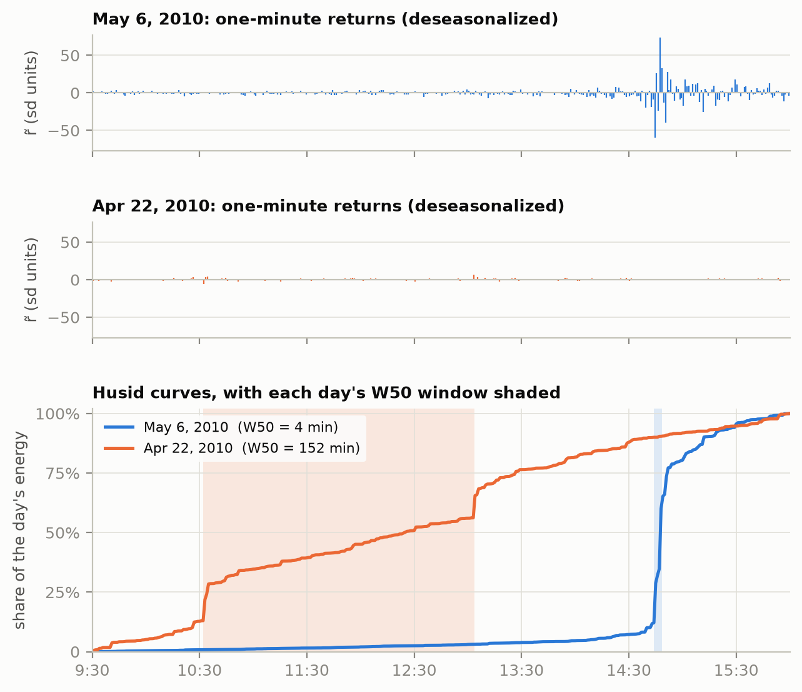
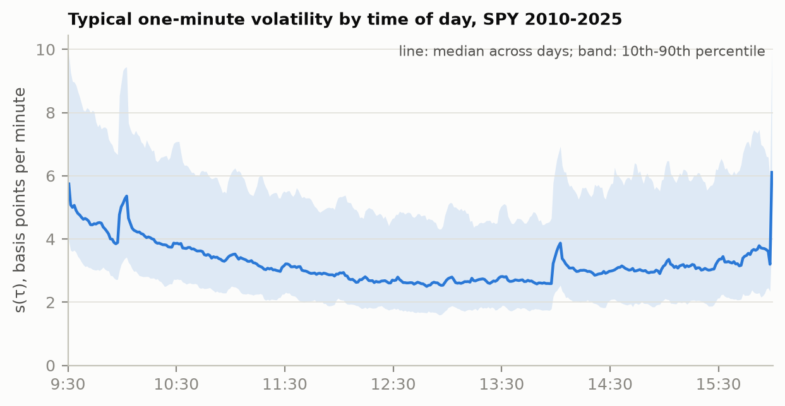

# Financial Arias Intensity (FAI)

**Does *how* a day's volatility arrives (one sharp burst or a slow grind) tell you anything
that the *amount* of volatility does not?**

This project borrows two tools from earthquake engineering and applies them to SPY, one
minute at a time, from 2010 to 2025:

- **Arias intensity**, the total energy of a ground-motion record. On returns it reduces to
  realized variance (RV), so RV is the benchmark to beat, not the contribution.
- **The Husid curve**, which shows how that energy accumulates over the record. From it
  come duration measures of how concentrated a day was, including **W50**: the shortest
  stretch of the day that holds half its energy.

It then asks whether concentration separates liquidity breakdowns (the 2010 Flash Crash)
from information-driven stress, and whether concentration and a bounded, Arias-style
liquidity weighting help forecast next-day VIX.

Esther Bioh · Independent Researcher · paper and v1.0 release planned for January 2027



*May 6, 2010 against a calm day chosen by a fixed rule. On the Flash Crash day, half the
day's energy arrived within 4 minutes (W50 = 4); on the typical day it took 152.*

## Results

All tests were registered before the data was downloaded ([`HYPOTHESES.md`](HYPOTHESES.md),
commit `0c666cb`). How each possible outcome would be read was written down before the run
([`paper/interpretation_table.md`](paper/interpretation_table.md)). Full output:
[`reports/h1_results.md`](reports/h1_results.md) and [`reports/h2_results.md`](reports/h2_results.md).

| Test | Question | Result |
|---|---|---|
| H1a | Are named liquidity crashes unusually concentrated for their volatility? | **Falsified.** May 6, 2010 is among the most concentrated days in its RV decile (percentile 0.3); Aug 24, 2015 is not (87): its crash came in the opening minutes, and the rest of the day stayed volatile. |
| H1b | Do concentrated days reverse more over the next 15-30 minutes? | **No detectable effect.** Slope −0.008 (t = −0.55). At the 95% bound, halving W50 lowers the variance ratio by at most 0.015, about a fifteenth of its day-to-day spread. |
| H1c | Positive control: are Fed (FOMC) days more concentrated? | **Holds on W50**: FOMC days' W50 is about 0.41 times that of similar-volatility days (t = −14.5), and they show no extra reversal. **Fragile on D5-75**, which misses late-day bursts like the 2:00 Fed statement. |
| Pivot check | Does the liquidity weighting change which days look intense? | **Barely** (correlation 0.996 with unweighted FAI), as the bound on the weighting implies. The paper is framed around concentration. |
| H2a | Does the liquidity weighting help predict next-day VIX? | **No.** The weighted measure has a small link to next-day VIX in 2010-2018 (t = −2.30), but it comes from the steps it shares with unweighted FAI: the weighting alone shows no effect (t = −0.39), a test with little power because the weighting moves a day's measure by only about 9%. The link does not survive the adjustment for testing seven hypotheses, and it does not improve forecasts for 2019-2025. |
| H2b | Does concentration help predict next-day VIX? | **Not as a forecast.** In 2010-2018 a more concentrated day is followed by a slightly larger VIX rise (about 0.5% for one standard deviation of W50, t = −2.39), but the result is fragile on D5-75, does not survive the adjustment for seven tests, and does not improve forecasts for 2019-2025. |

What this says: W50 measures concentration well (it passes the FOMC check and singles out
May 6), but in SPY concentration does not tell a liquidity breakdown from scheduled news,
and it does not help forecast next-day VIX. This is the negative result the registration
said would be reported: in SPY at one-minute resolution, the timing of volatility within
the day carries no forecasting information beyond realized variance. In the
[event table](reports/event_table.md), three of the five days matched to the 2018
"Volmageddon" selloff are Fed announcement days, and they are as concentrated as it is.

Still to come: robustness checks (existing measures of uneven volatility, a differenced
signal, leaving out Fed Chair appearances), then the paper in January 2027.

## How the research is run

- **Registered first.** Hypotheses, tests and the significance rule were committed before
  any data. Every later change is logged with its reason in [`DECISIONS.md`](DECISIONS.md),
  and each rule is pushed before the code that applies it runs.
- **Tested against fake results.** Before any real reversal test, the pipeline was run on
  simulated markets where nothing reverses. The registered reversal measure found a
  reversal 78% of the time when bid-ask spreads widened in bursts, so it was replaced
  twice (D-023, D-024) until it passed every scenario. The original is still reported.
- **Calibrated.** A positive control (FOMC days) checks the instrument on a case with a
  known answer before the main test is read.
- **Reported either way.** Negative and fragile results are reported as they came out,
  next to every registered variant.

## Measures

| Measure | What it is |
|---|---|
| RV | Realized variance: the sum of squared one-minute returns. The benchmark. |
| FAI | Energy of deseasonalized returns relative to the previous 60 days. |
| Husid curve | The share of the day's energy accumulated by each minute. |
| W50 | The shortest window holding half the day's energy. Short = concentrated. |
| D5-75 | Time from 5% to 75% of the energy, the seismology standard (Bommer et al. 2009). |
| VR** | A variance ratio built to ignore bid-ask bounce; below 1 means prices partly undo their moves within 15-30 minutes. |
| FAI_w | FAI with each minute weighted by its illiquidity (Amihud), between 1 and π/2, following Arias' damping factor. |



*The intraday pattern that deseasonalizing removes, with the 10:00 data releases, the
2:00 Fed announcements and the close.*

## Reproduce

```bash
python -m venv .venv
source .venv/bin/activate              # Windows: .venv\Scripts\activate
pip install -e ".[dev]"
pytest

cp .env.example .env                   # add your Alpha Vantage key
python scripts/download.py alphavantage --symbol SPY --start 2009-01 --end 2025-12
python scripts/download.py vix
python scripts/run_all.py --vendor alphavantage --symbol SPY            # flagged prints kept
python scripts/run_all.py --stages clean,measures --drop-spikes          # primary: flagged prints removed

python scripts/h1_tests.py             # reports/h1_results.md
python scripts/h2_tests.py             # reports/h2_results.md (reads h1_results.csv for the Holm adjustment)
python scripts/pivot_check.py          # reports/pivot_check.md
python scripts/event_table.py          # reports/event_table.md
python scripts/fig_may6.py             # paper/figures/may6_vs_calm.png
python scripts/fig_ushape.py           # paper/figures/intraday_profile.png
```

The simulation checks behind the reversal measure: `scripts/sim_h1b_null_pipeline.py`,
`sim_h1b_null_d023.py` and `sim_h1b_null_d024.py`, with results in `reports/`.

## Layout

```
HYPOTHESES.md   the registered hypotheses and tests
DECISIONS.md    every change since, with its reason and date
scripts/        download, pipeline, tests (h1_tests, h2_tests, pivot_check, event_table), figures, simulations
src/fai/        ingest, sessions, clean, seasonality, husid, measures, liquidity, weighting,
                detection, inference, sim, vix
tests/          unit tests, incl. recovery of simulated ground truth; CI runs them on every push
reports/        computed results (no vendor data)
paper/          LaTeX draft, interpretation table, figures
ref/            small hand-maintained tables (FOMC and release dates, SPY dividends)
data/           gitignored; recreated by scripts/download.py
```

## Data licensing

Raw vendor data is never committed. The repository holds the scripts that download it and
only derived, per-day measures.
